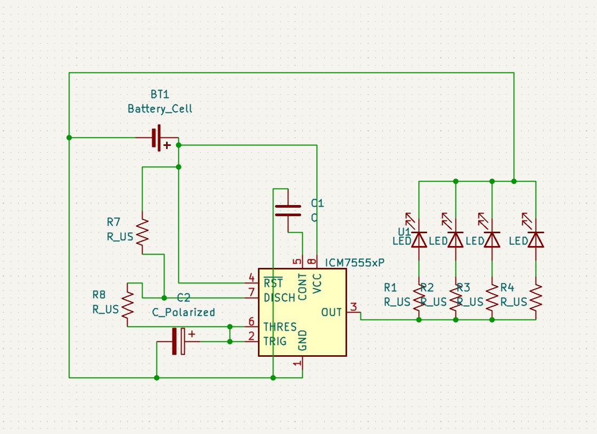
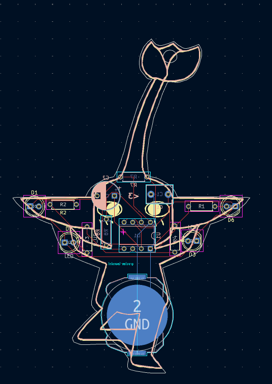
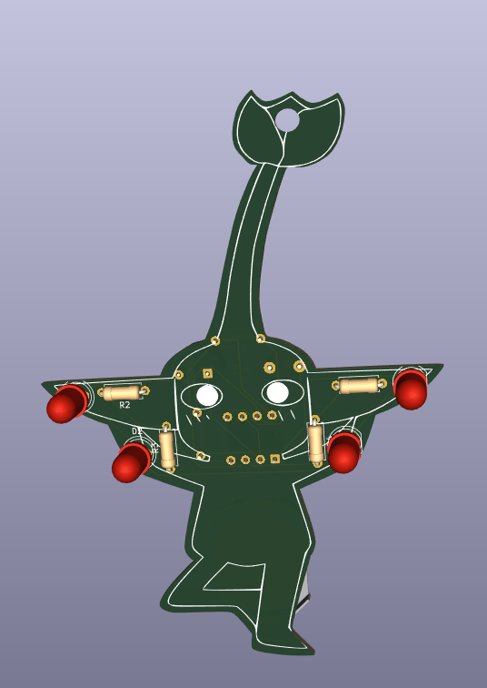
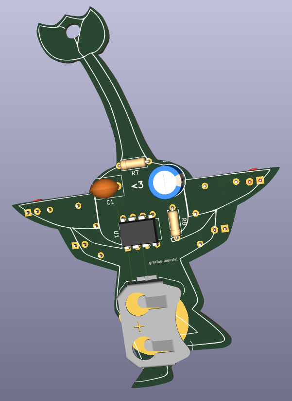

# Pikmin ornament

## What it is?
Is a christmas tree ornament PCB designed with the shape of a pikmin. The lights blink every few seconds being driven by a 555 timer
and powered by a 3v coin cell battery. I was inspired by those images of the yellow pikmin with the christmas leds! lovethem

## BOM

| Component | Value | Quantity |
|------|-------|----------|
| 555 timer | - | 1 |
| Coin cell battery holder | - | 1 |
| Capacitor | (10µF) | 1 |
| 5mm LED | - | 4 |
| Not polarized capacitor |(100nF) | 1 |
| Resistor | 470Ω | 4 |
| Resistor | 4.7kΩ | 1 |
| Resistor | 47kΩ | 1 |

## Schematic

## PCB

## 3D View

### Slack
@ant.tenn4
